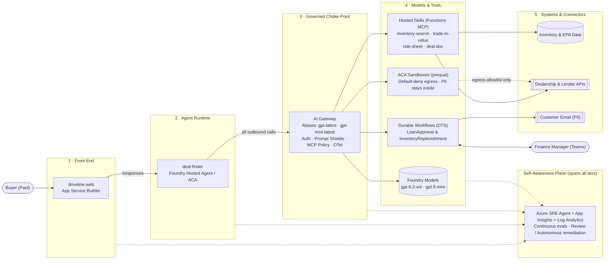

# Azure App Platform: Architecture & Reference Design

Azure App Platform brings together Azure's serverless and AI-native building blocks, with **ACA Sandboxes** as the focal primitive for strongly isolated execution, into one coherent application platform: a fast web front end on **App Service Builder**, a reasoning agent on **Foundry Hosted Agents** or **Azure Container Apps**, governed model and tool access through **AI Gateway**, callable **Hosted Skills** on Azure Functions MCP, hardware-isolated compute for sensitive work, durable human-in-the-loop workflows on **Durable Task Scheduler (DTS)**, and **Connectors** into Microsoft 365 and enterprise systems.

Three architectural pillars hold across every template in this repository:

1. **Self-awareness from day one**: Observability, diagnosis, and human-reviewed or autonomous remediation span every tier via **Azure SRE Agent** (`Microsoft.App/agents`), OpenTelemetry traces, Application Insights, and Log Analytics.
2. **Environment safety outside the prompt**: Identity, microVM isolation, and network egress controls are enforced by the platform boundary rather than prompt instructions. Every outbound agent call passes through **AI Gateway**, and untrusted or PII-bearing computation runs inside **ACA Sandboxes** behind a default-deny egress proxy.
3. **Uniform interfaces**: Capabilities expose consistent HTTP APIs, OpenAPI specs, SDKs, MCP servers, and CLI commands so humans and agents operate through the same contracts.

---

## 1. Platform Capabilities

| # | Capability | Azure Service / Primitive |
| --- | --- | --- |
| 1 | **Web front end** | **Azure App Service Builder** (`builder.yaml`) |
| 2 | **Collaboration surface** | **Microsoft Teams & Outlook** via managed **Connectors** |
| 3 | **Intelligence & reasoning** | **Microsoft Foundry Hosted Agents** / **Azure Container Apps** (Responses API) |
| 4 | **Single governed choke point** | **Azure AI Gateway** (model routing, Prompt Shields, quotas, MCP tool policy, OTel) |
| 5 | **Domain skills** | **Hosted Skills** on **Azure Functions** (`/runtime/webhooks/mcp`, scale-to-zero) |
| 6 | **Isolated execution & PII boundary** | **ACA Sandboxes** (`Microsoft.App/sandboxGroups` + default-deny egress proxy) |
| 7 | **System-of-record integration** | **Azure Connector Namespace** |
| 8 | **Durable orchestration & HITL** | **Durable Task Scheduler (DTS)** + **Durable Functions** |
| 9 | **Operational self-awareness** | **Azure SRE Agent** (`Microsoft.App/agents`) across every tier |

### 1.1 Identity: Microsoft Entra ID at Every Boundary

- **Front end (web, Teams, email)**: Signed-in user identity with on-behalf-of (OBO) delegation where user-scoped permissions apply.
- **Agent and backend tiers (Foundry Hosted Agent, AI Gateway, Hosted Skills, Sandboxes, Workflows, SRE Agent)**: Dedicated **Managed Identity** and **Entra Agent ID**, giving every autonomous actor an independently auditable principal with zero static keys in source code.

### 1.2 Environment Safety: The Environment Is the Policy

Grounded in the [Azure SRE Agent environment-safety architecture](https://commandline.microsoft.com/azure-sre-agent-restricting-environment-ai-safety/), Azure App Platform enforces four layered controls:

- **Single governed choke point (AI Gateway)**: All outbound agent calls to models, sandboxes, Hosted Skills, and workflow/communication endpoints traverse AI Gateway first for authentication, rate limits, content safety, and OpenTelemetry correlation.
- **Reasoning separated from untrusted execution (ACA Sandboxes)**: Sensitive calculations (such as borrower PII loan pre-qualification) and untrusted document parsing execute inside ephemeral hardware-isolated microVMs that cannot inspect host secrets or orchestration state.
- **Credentials used, never possessed**: When a sandboxed tool needs to call an approved external API, the Sandboxes egress proxy injects credentials outside the microVM (`secretRef` or `managedIdentityRef`) so raw tokens never enter `os.environ` or the container filesystem.
- **Risk-classified human approval**: Routine read-only diagnostics run automatically, while high-impact business commitments (wholesale inventory orders, binding loan offers, production config changes) pause in **Review mode** or **DTS external-event gates** for human sign-off.

---

## 2. Reference Architecture

### 2.1 End-to-End Topology with the Self-Awareness Plane

### 2.2 Progressive Sandbox & AI Gateway Architecture

Teams can start with the smallest standalone template (`templates/sandboxes-minimal` or `templates/sandbox-gateway-minimal`) and add capabilities incrementally without changing the core safety boundary:

1. **Sandboxes Minimal (`templates/sandboxes-minimal`)**: Single agent dispatching untrusted work to ACA Sandboxes protected by the default-deny egress proxy.
   
2. **Sandboxes + AI Gateway Minimal (`templates/sandbox-gateway-minimal`)**: Routes all model and sandboxed tool calls through AI Gateway so multiple agents and Hosted Skills can safely share tools and models.
   
3. **Minimal + Durability & Human-in-the-Loop**: Adds Durable Task Scheduler (DTS) turn checkpointing and Teams/email human approval gates.
   
4. **Minimal + SRE Observability & Continuous Evals**: Adds continuous evaluation monitors and Azure SRE Agent cross-layer correlation.
   
5. **Complete Reference Architecture (`templates/dealership-e2e`)**: Combines App Service Builder, Hosted Agent, AI Gateway, ACA Sandboxes, Hosted Skills, DTS workflows, Connectors, and SRE Agent.
   

---

## 3. Walkthrough: Dealership Reference Application (`templates/dealership-e2e`)

1. **Search & discover (`inventory-search`)**: Paul opens `driveline-web` (deployed on Azure App Service Builder via `builder.yaml`) and asks for EVs under `$40,000` with at least `250` miles of range. `driveline-web` streams over `/responses` to `deal-finder`. The agent addresses AI Gateway model aliases (`gpt-latest` for deep synthesis and `gpt-mini-latest` for fast filter turns, backed by `gpt-6.2-sol` and `gpt-5-mini`) and calls `inventory-search` through AI Gateway to return matching vehicles backed by real EPA range specs (`fueleconomy.gov`).
2. **Trade-in & net quote (`trade-in-value`)**: Paul asks what his trade-in is worth; `deal-finder` invokes the `trade-in-value` Hosted Skill through AI Gateway to compute vehicle appraisal and net price.
3. **PII-isolated pre-qualification (`ACA Sandboxes`)**: Before committing, Paul checks financing options. Borrower income and sensitive identifiers are evaluated inside an ephemeral `prequal` ACA Sandbox with default-deny egress. Raw PII never enters model prompts, application databases, or telemetry logs; only `{credit_band, approved, apr_percent, monthly_payment}` returns.
4. **Financing comparison (`rate-sheet`)**: The `rate-sheet` Hosted Skill computes 36-, 48-, and 60-month APR and payment schedules for the returned credit tier.
5. **Durable manager approval (`DTS` + `Teams`)**: Submitting the deal starts `LoanApprovalOrchestrator` on Durable Functions + DTS, which routes an approval request to a finance manager in Microsoft Teams while racing a durable timer against the external approval event. If the host restarts mid-review, DTS resumes from the exact checkpoint.
6. **Binding offer delivery (`deal-doc` + `Email`)**: Once approved, `deal-doc` generates the itemized buyer order and emails the offer package to the shopper.
7. **Self-awareness in operation (`Azure SRE Agent`)**: Across the entire flow, Azure SRE Agent monitors telemetry and domain health (including `inventory-health-check`), correlating anomalies with deployment history and staging human-approved remediations or inventory replenishment workflows (`InventoryReplenishmentOrchestrator`).

---

## 4. Service Roles & Jobs To Be Done

| Capability | Azure Service | Platform Job To Be Done | Dealership Reference Instance | Public Documentation |
| --- | --- | --- | --- | --- |
| **Web Front End** | Azure App Service Builder | Ship modern web UIs and streaming server routes from a declarative `builder.yaml` manifest. | `driveline-web` Next.js buyer chat, vehicle shortlist, and live deal-status panel. | [App Service Builder](https://builder.appservice.azure.com) |
| **Hosted Agent** | Microsoft Foundry Hosted Agents / ACA | Run stateful, code-owned conversational agents over the Responses protocol with dedicated Entra Agent ID. | `deal-finder` Python Microsoft Agent Framework service orchestrating search, pricing, pre-qual, and approval. | [Foundry Hosted Agents](https://learn.microsoft.com/azure/ai-foundry/agents/concepts/hosted-agents) |
| **Governance** | Azure AI Gateway | Mediate all model, sandbox, and MCP tool traffic with auth, Prompt Shields, token quotas, routing, and OTel. | Single governed choke point between `deal-finder` and Foundry models, `prequal` sandbox, and all 4 MCP skills. | [AI Gateway Overview](https://learn.microsoft.com/azure/api-management/ai-gateway-overview) |
| **Hosted Skills** | Azure Functions MCP | Expose deterministic, scale-to-zero domain tools over MCP (`/runtime/webhooks/mcp`) and event triggers. | `inventory-search`, `trade-in-value`, `rate-sheet`, and `deal-doc` Python v2 Function Apps. | [Serverless Agents Runtime](https://learn.microsoft.com/azure/azure-functions/functions-serverless-agents-runtime) |
| **Sandboxes** | ACA Sandboxes | Execute untrusted files, generated code, or PII math in ephemeral microVMs with default-deny egress. | `prequal` loan pre-qualification container and `document-validation` redaction/injection boundary. | [ACA Sandboxes Overview](https://learn.microsoft.com/azure/container-apps/sandboxes-overview) |
| **Durable State & HITL** | Durable Task Scheduler (DTS) | Persist multi-step workflows and human-approval waits across restarts, timeouts, and redeployments. | `LoanApprovalOrchestrator` (finance sign-off) and `InventoryReplenishmentOrchestrator` (stock restock approval). | [Durable Task Scheduler](https://learn.microsoft.com/azure/durable-task/scheduler/durable-task-scheduler) |
| **Connectors** | Azure Connector Namespace | Integrate with Teams, Outlook, and enterprise systems of record with managed OAuth, retries, and throttling. | Teams manager approval cards, customer offer email delivery, and dealership/lender system integration. | [Connector Namespace Overview](https://learn.microsoft.com/azure/connector-namespace/connector-namespace-overview) |
| **Self-Awareness** | Azure SRE Agent | Continuously observe every tier, correlate telemetry with deployments and incident memory, and propose safe fixes. | `sre-dealership-agent` monitoring App Service, AI Gateway, Functions skills, and low-stock replenishment in Review mode. | [Azure SRE Agent Overview](https://learn.microsoft.com/azure/sre-agent/overview) |

---

## 5. Reference Implementation Stack

| Tier | Technology |
| --- | --- |
| **Web Front End** | TypeScript, Next.js (`standalone` output) or Vite, `builder.yaml` |
| **Agent Runtime** | Python 3.13 (`uv`), `agent-framework`, `azure-ai-agentserver-agentframework`, Responses API |
| **AI Gateway** | Azure API Management AI Gateway governing model aliases (`gpt-latest`, `gpt-mini-latest`) and all sandbox/MCP tool calls |
| **Foundry Models** | Fresh model deployments behind AI Gateway aliases (`gpt-6.2-sol` + `gpt-5-mini`) via Managed Identity RBAC |
| **Hosted Skills** | Python v2 Azure Functions, `azurefunctions-agents-runtime`, MCP webhook endpoint (`/runtime/webhooks/mcp`) |
| **Sandboxes** | Containerized Python tools on `Microsoft.App/sandboxGroups` with `egress-policy.yaml` (`defaultAction: Deny`) |
| **Workflows** | Azure Durable Functions (Python v2) backed by `Microsoft.DurableTask/schedulers` |
| **Operations** | `Microsoft.App/agents` (Azure SRE Agent), OpenTelemetry, Application Insights, Log Analytics |
| **Infrastructure** | Azure Developer CLI (`azd`) + modular Bicep (`infra/` and `infra-ai-gateway/`) |
